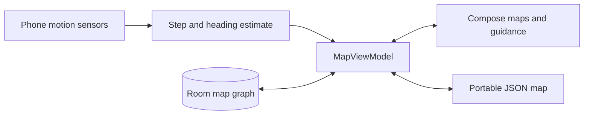

# IndoorPulse

**Survey a building on Android, then guide someone from the entrance to a room on another floor.**

IndoorPulse is an offline-first indoor mapping and navigation prototype for places where GPS cannot reliably tell you which corridor or floor you are on. A surveyor builds a map from landmarks and walkable connections. Visitors choose a known entrance, preview the route, and follow guidance through corridors, stairs, and elevators. Once a map is available on the phone, the core workflow uses local data and built-in motion sensors. It needs no account, installed beacons, or Wi-Fi fingerprint survey.

[Try the Android demo](#try-the-android-demo) · [Build from source](#build-from-source)

## What you can do

| Workflow | What IndoorPulse provides |
| --- | --- |
| **Navigate** | Search by room, place type, or floor. Preview a route before walking, choose **Avoid stairs**, confirm floor transfers, and see when you arrive. **Find exit** routes to a reachable mapped exit or building entrance. |
| **Explore** | Orbit the 3D floor stack and inspect linked floors. Elevators use violet squares and solid shafts. Stairs use amber diamonds and dashed links. The viewer can show another floor while live navigation stays on your current one. |
| **Survey and share** | Place and connect landmarks, extend a portal to another floor, and correct edits with undo and redo. Export a JSON backup and import it as a separate building map. |

## Try the Android demo

Open the app on Android 10 or later. The fictional **Demo Learning Centre** is bundled with the app and works with location permission off. Use the debug APK from the [build instructions](#build-from-source) or run the `app` configuration from Android Studio.

1. Open **Try demo map** and choose **Front Entry**.
2. Turn on **Avoid stairs**. Tap **Find a destination**, search for **Room 104**, and tap **Preview** beside the result. Use **Next** to see the route from L0 through the elevator to L1.
3. Tap **Done**, open **3D map**, and drag to orbit. Tap the elevator marker to inspect its linked floors. Open the floor selector to adjust spacing or focus a level.
4. Back on the map, tap the destination’s name to start live guidance. From the demo entrance, **Find exit** can immediately report **At the mapped exit**, since the entrance is an eligible exit and you start there.

## How it works



- **Position.** The motion pipeline estimates stride and heading from sensor events. A particle filter estimates the next position, with constraints from mapped corridors on the current floor during navigation. The route and map marker use the same published pose.
- **Routing.** The app searches a building graph whose edges connect rooms, junctions, entrances, and floor portals. The visitor confirms a portal transfer on arrival at the new floor.
- **Storage.** Room keeps the graph on the device. Import remaps node and edge IDs in one transaction so a backup can coexist with the open building.

The main entry points are the [Compose screens and renderers](app/src/main/java/com/indoorpulse/presentation/ui), [MapViewModel](app/src/main/java/com/indoorpulse/presentation/viewmodel/MapViewModel.kt), [motion sensors](app/src/main/java/com/indoorpulse/data/sensor), [particle filter](app/src/main/java/com/indoorpulse/domain/navigation/ParticleFilter.kt), and [Room database](app/src/main/java/com/indoorpulse/data/local/IndoorPulseDatabase.kt).

## Build from source

| Requirement | Version or configuration |
| --- | --- |
| Android Studio and JDK | Android Studio compatible with AGP **9.4.1**. Select the bundled JDK as the Gradle JDK. The verified Windows build used JetBrains Runtime **25.0.3**. [AGP compatibility](https://developer.android.com/build/releases/agp-9-4-0-release-notes) |
| Android SDK | Install **Android SDK Platform 37**, the Build Tools requested by Gradle, and Platform-Tools to run on a device. Compile and target SDK are **37**. Minimum runtime is **API 29 (Android 10)**. |
| Build toolchain | Gradle Wrapper **9.8.0**, Kotlin Compose plugin **2.2.10**, KSP **2.3.6**. |
| Main libraries | Compose BOM **2026.02.01**, Room **2.6.1**, Kotlin coroutines **1.8.0**, Google Play services Location **21.3.0**. See the [version catalog](gradle/libs.versions.toml) for the full list. |

1. Clone the [IndoorPulse Android repository](https://github.com/rizwanhanda/IndoorPulse-Android) using Android Studio’s **Get from VCS** and open the project root.
2. Install the SDK platform in **SDK Manager**, select the bundled Gradle JDK, and sync the project. The first sync downloads dependencies. Android Studio creates `local.properties` with `sdk.dir`. For command-line builds, point `JAVA_HOME` to the Gradle JDK and ensure the SDK path is configured.
3. Select the **app** run configuration and an emulator or device with API 29 or later, then click **Run**. Room creates its database and loads the fictional demo during startup. No application credentials or separate data download are required.

Run from the repository root in Windows PowerShell.

```powershell
.\gradlew.bat --no-configuration-cache :app:assembleDebug :app:testDebugUnitTest :app:lintDebug
```

On macOS or Linux, invoke the wrapper through `sh`.

```bash
sh ./gradlew --no-configuration-cache :app:assembleDebug :app:testDebugUnitTest :app:lintDebug
```

The debug build produces an installable, debug-signed APK at `app/build/outputs/apk/debug/app-debug.apk`. To assemble the release variant, run `:app:assembleRelease` with the same wrapper. The release APK needs signing before distribution. Keep signing keys and credentials outside the repository.

## Tests and verification

The Android v1.0 build from [revision `16c6cab`](https://github.com/rizwanhanda/IndoorPulse-Android/tree/16c6cab) passed **35 JVM tests** and **15 instrumented tests** on a Nothing Phone (2). The device suite used isolated maps and covered route preview, mapped exits, floor confirmation, arrival, survey edits, backup import, and 3D floor inspection.

| Check | Gradle task | Results |
| --- | --- | --- |
| JVM tests | `:app:testDebugUnitTest` | HTML at `app/build/reports/tests/testDebugUnitTest/index.html` and XML under `app/build/test-results/testDebugUnitTest/` |
| Android tests | `:app:connectedDebugAndroidTest` | Connect an emulator or device first. Find the report under `app/build/reports/androidTests/connected/`. |
| Android lint | `:app:lintDebug` | `app/build/reports/lint-results-debug.html` |

The [JVM tests](app/src/test/java/com/indoorpulse) and [device tests](app/src/androidTest/java/com/indoorpulse) are included in this repository. The debug APK and the Android test APK serve different purposes. To build just the test APK, run `:app:assembleDebugAndroidTest`.

## Current scope

- **Building coverage.** Nearby discovery uses an optional foreground location fix to shortlist saved maps by their stored reference points. A building needs a map before visitors can route through it. Users can always choose a saved map manually.
- **Walking accuracy.** Dead reckoning can drift with handset orientation, walking pattern, and map alignment. The regression tests exercise controlled positions. Measured walking accuracy, battery use, and real-building discovery still need dedicated field trials.
- **Access and exits.** Avoid stairs uses mapped stair nodes. Before relying on a route, confirm real-world access and elevator operation. In an emergency, follow posted instructions and staff directions.
- **Map files.** Exported files can contain building coordinates, floor layouts, and room labels. Use the fictional demo when sharing publicly. Back up saved maps before upgrading from an older database schema, since unsupported migrations can recreate the local database.

## Project

IndoorPulse was developed by **Team Navix** for UCS503 Software Engineering Lab at Thapar Institute of Engineering and Technology.
